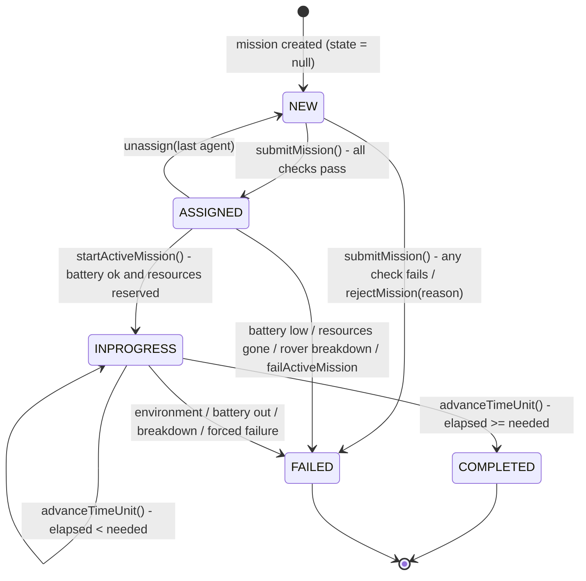
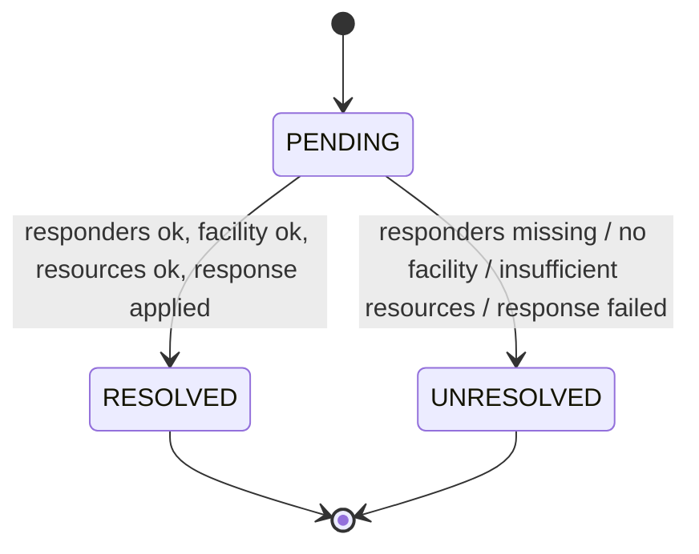
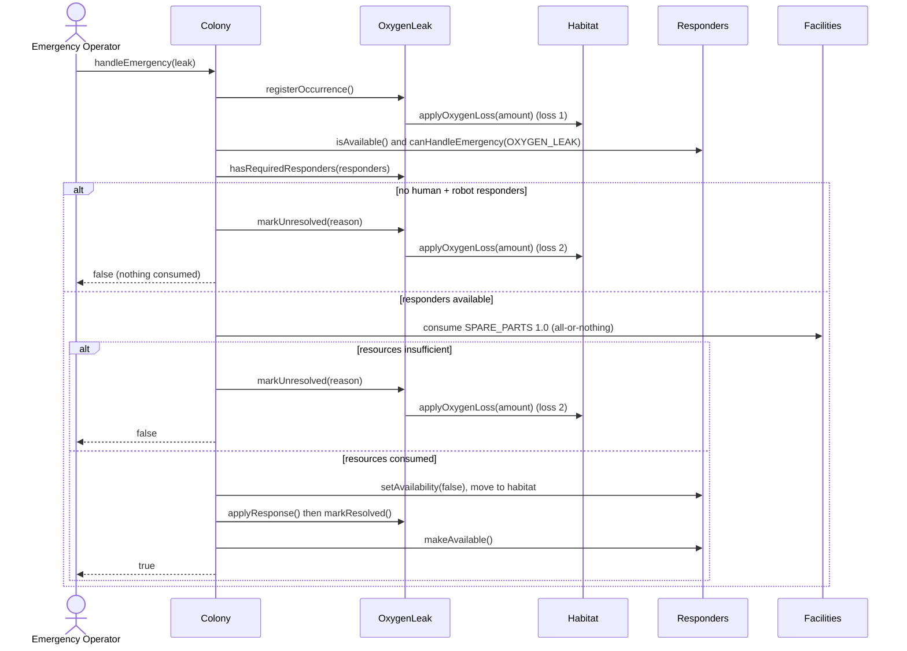
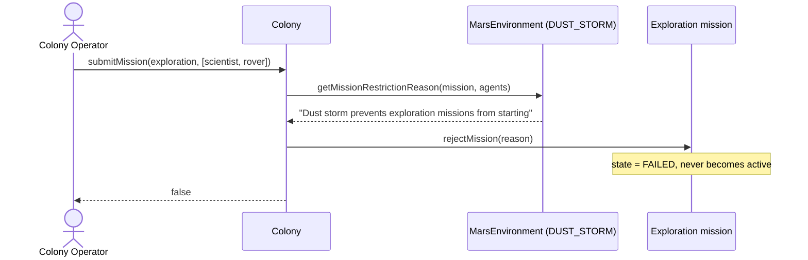
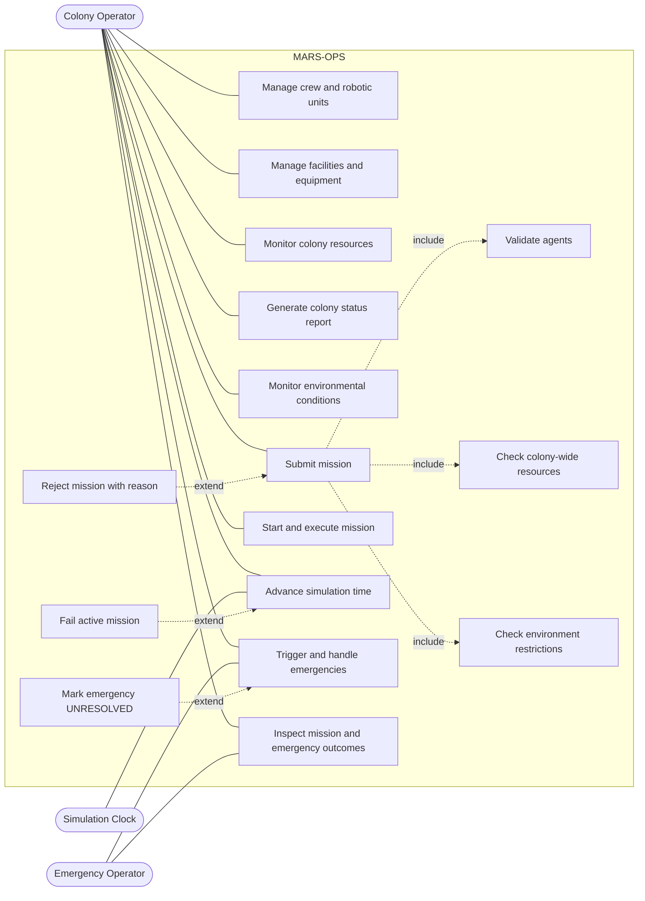

# MARS-OPS - Autonomous Mars Colony Management & Emergency Simulator

MARS-OPS is a Java simulation of a small research colony on Mars. It manages people, robots,
facilities and resources, accepts missions, advances simulated time, reacts to the Martian
environment and handles emergencies. The point of the project is **object collaboration**: the
colony asks its objects what they can do instead of checking their concrete types.

* Language: Java (uses records and pattern-matching `instanceof`, so Java 16+; developed on Java 26)
* Console demo (the five required scenarios): `src/Main.java`
* Graphical admin console: `src/admingui/AdminGuiMain.java`
* UML (all five diagrams, editable): `mars colony (4).drawio` (open with <https://app.diagrams.net> or the draw.io desktop app)

---

## Table of contents

1. [How to compile and run](#1-how-to-compile-and-run)
2. [System overview and main components](#2-system-overview-and-main-components)
3. [Design decisions and relationships](#3-design-decisions-and-relationships)
4. [Mission rules and mission states](#4-mission-rules-and-mission-states)
5. [Resource allocation rules](#5-resource-allocation-rules)
6. [Environmental effects](#6-environmental-effects)
7. [Emergency rules](#7-emergency-rules)
8. [Simulation and time](#8-simulation-and-time)
9. [The five required demonstration scenarios](#9-the-five-required-demonstration-scenarios)
10. [UML diagrams](#10-uml-diagrams)
11. [Assumptions and known limitations](#11-assumptions-and-known-limitations)
12. [Admin GUI and sound](#12-admin-gui-and-sound)

---

## 1. How to compile and run

All commands are run from the project root (the folder that contains `src/`).

**Console demo - runs all five required scenarios**

```bash
javac -d out/manual -sourcepath src src/Main.java
java  -cp out/manual Main
```

**Admin GUI**

```bash
javac -d out/manual -sourcepath src src/admingui/AdminGuiMain.java
java  -cp out/manual admingui.AdminGuiMain
```

**In IntelliJ IDEA:** open the folder, mark `src` as the sources root, then run `Main` (console demo)
or `admingui.AdminGuiMain` (GUI) with the green arrow next to `main`. Run from the project root so
the optional sound files in `assets/` are found.

---

## 2. System overview and main components

| Package | Responsibility |
|---|---|
| `colony` | `Colony` - the central coordinator. Owns the lists of personnel, robots, facilities, missions and emergencies. Enforces the one-active-mission rule, computes colony-wide resource totals, allocates resources, and handles emergencies. |
| `agents` | `Agent` interface - the capability contract (`canPerform(Mission)`, `canHandleEmergency(EmergencyType)`, `hasSkill`, `hasCapability`, `isAvailable`, battery hooks). |
| `personnel` | `Personnel` (abstract, implements `Agent`) with `Scientist`, `Engineer`, `MedicalOfficer`. Name, id, health, location, skills, fatigue, availability. |
| `roboticunit` | `RoboticUnit` (abstract, implements `Agent`) with `ExplorationRover`, `RepairRobot`, `Drone`. Battery, health, location, capabilities, equipment. |
| `facilities` | `Facilities` (abstract) with `Habitat`, `Laboratory`, `StorageFacility`, `PowerStation`, `CommunicationStation`; plus `Equipment` and `LifeSupportSystem`. Each facility has location, capacity, operational status, resources, equipment, occupants. |
| `missions` | `Mission` (abstract, owns the mission lifecycle) with `Exploration`, `Repair`, `Research`, `Rescue`. |
| `emergencies` | `Emergency` (abstract, owns the emergency lifecycle) with `OxygenLeak`, `Fire`, `RoverBreakdown`, `medicalEmergency`. |
| `marsenvironment` | `MarsEnvironment` - holds the current environmental condition and answers "does this condition forbid or break this mission?". |
| `simulation` | `Simulation` - the clock. `advanceTime(colony, n)` moves the simulation forward one unit at a time. |
| `enums` | `Capability`, `Skills`, `Resources`, `OperationalStatus`, `FacilityType`, `EmergencyType`, `EmergencyStatus`, `Mission_Emergency_States`, `EnviromentStates`. |
| `admingui`, `gui` | Swing user interfaces on top of the model (no simulation logic lives in them). |

### How the pieces collaborate

```
Operator --submitMission(mission, agents)--> Colony
Colony   --isAvailable()/canPerform(mission)--> each Agent          (capability question)
Colony   --hasValidTeamComposition(agents)--> Mission               (team-level question)
Colony   --getMissionRestrictionReason(..)--> MarsEnvironment       (environment question)
Colony   --checkresources(colony totals)--> Mission                 (resource question)
Colony   --assign(agent)--> Mission --assignMission(mission)--> Agent
```

Nobody checks `instanceof Engineer`. Each `Agent` answers for itself, and each `Mission` /
`Emergency` subclass decides what a valid team looks like. That is how polymorphism is used here.

---

## 3. Design decisions and relationships

### Why an `Agent` interface?
Section 6.1 of the specification asks for `agent.canPerform(mission)` instead of type checks. People
and robots have no common parent class, so they share an **interface**. The colony treats both kinds
of responder and mission worker uniformly (`getAvailableResponders`, `submitMission`).

### The four required relationships

| Relationship | Where it is used | Why this one | In Java |
|---|---|---|---|
| **Inheritance** (is-a) | `Engineer`/`Scientist`/`MedicalOfficer` extend `Personnel`; `ExplorationRover`/`RepairRobot`/`Drone` extend `RoboticUnit`; `Habitat`/`Laboratory`/`StorageFacility`/`PowerStation`/`CommunicationStation` extend `Facilities`; `Exploration`/`Repair`/`Research`/`Rescue` extend `Mission`; `OxygenLeak`/`Fire`/`RoverBreakdown`/`medicalEmergency` extend `Emergency` | Each subtype really is a more specific version of its parent and overrides behaviour (`canPerform`, `hasValidTeamComposition`, `applyResponse`) | `class Engineer extends Personnel` |
| **Realization** | `Personnel` and `RoboticUnit` implement `Agent` | Two unrelated hierarchies share one capability contract | `implements Agent` |
| **Composition** (strong ownership) | `Habitat` owns its `LifeSupportSystem` | The life-support system is created inside the habitat and has no life without it | `private final LifeSupportSystem lifeSupport = new LifeSupportSystem();` in the `Habitat` constructor |
| **Aggregation** (whole-part, parts live on their own) | `Colony` has personnel, robots, facilities, missions, emergencies; `Facilities` and `RoboticUnit` have `Equipment` | The parts are created outside and added with `addPersonnel`, `addRobot`, `addFacility`, `setEquipment`; they could be moved elsewhere | `List<Personnel> personnel` filled by `addPersonnel(p)` |
| **Association** (uses) | `Mission` - `Agent` (a mission works with agents and an agent knows its mission); `Mission` - `Facilities` (target/location); `Emergency` - `Facilities`; `Colony` - `MarsEnvironment` | Each side can exist without the other | `Mission.agents`, `Mission.facility`, `Colony.marsEnvironment` |

Other design choices:

* **Mission and emergency lifecycles live inside the objects.** `Mission.failMission`, `finishMission`, `startMission`, `advanceTimeUnit` and `Emergency.markResolved` / `markUnresolved` own their state transitions and guard them with exceptions. The colony only coordinates.
* **State is an enum**, not strings (`Mission_Emergency_States`, `EmergencyStatus`, `OperationalStatus`).
* **Template-method hooks**: `Emergency.onOccurrence()` / `onUnresolved()` and `Mission.onSuccessfulCompletion()` let subclasses add their own side effects (oxygen loss, repair performed, experiment completed) without the base class knowing about them.
* **Defensive copies and validation**: getters return copies of lists/maps; constructors and setters reject `null`, blank, negative and non-finite values.
* The emergency class is named `medicalEmergency` (lower-case `m`) and its file is `medicalEmergency.java`, matching the name used throughout the code.

---

## 4. Mission rules and mission states

### Mission types and team requirements

| Mission | Required team (checked by `hasValidTeamComposition`) | Who can be assigned (`canPerform`) |
|---|---|---|
| **Exploration** | one agent with skill `SCIENTIFIC` **and** one robot with `SURFACE_TRAVEL` + `EQUIPMENT_CARRYING` that carries at least one operational equipment item | Scientist (`SCIENTIFIC`); robots whose capabilities include the mission's required capabilities, with enough battery |
| **Repair** | one agent with skill `MECHANICAL` **and** one agent with capability `EQUIPMENT_REPAIR`; the repair target must be `DAMAGED` | Engineer (`MECHANICAL`); repair robots |
| **Research** | one agent with skill `SCIENTIFIC` **and** an `OPERATIONAL` laboratory containing operational `SCIENTIFIC` equipment; facility must be a `Laboratory` | Scientist (`SCIENTIFIC`) |
| **Rescue** | one agent with skill `COMMUNICATION` **and** a vehicle (`SURFACE_TRAVEL` or `ACCESS_INACCESSIBLE_AREAS`) | Scientist, Engineer or Medical Officer with `COMMUNICATION`; rover/drone |

A robot is also rejected if its battery is below `neededTimeUnits x 1.0` (battery cost is 1 per time unit).

### One active mission at a time

`Colony.submitMission(mission, agents)` runs these checks **in this order** and rejects the mission at
the first one that fails. A rejected mission becomes `FAILED` immediately, stores a clear
`failureReason`, is recorded in the colony's mission list, and **never becomes the active mission**:

1. the agent list is not null/empty
2. no other mission is active - *"Another mission is already active"*
3. for every agent: not null, not duplicated, available, and `canPerform(mission)` - *"Agent is unavailable"*, *"Agent lacks required capabilities"*
4. `mission.hasValidTeamComposition(agents)` - *"Mission team does not meet its requirements"*
5. `MarsEnvironment.getMissionRestrictionReason(...)` - e.g. *"Dust storm prevents exploration missions from starting"*
6. colony-wide resources cover the mission's needs - *"Insufficient resources for mission"*

If everything passes, the mission becomes `ASSIGNED`, becomes the colony's active mission, and every
agent becomes unavailable. **Failed missions are never retried**; create a new `Mission` to try again.
Several agents may be on one mission, and **all are released when the mission ends** (`COMPLETED` or
`FAILED`).

### Mission states



| State | Meaning |
|---|---|
| *(null / NEW)* | Created but not accepted. Not in the enum - `Mission.getState()` returns `null`. |
| `ASSIGNED` | Accepted. Is the colony's active mission. Agents are reserved. Resources are **not** consumed yet. |
| `INPROGRESS` | Started with `Colony.startActiveMission()`. Resources have been deducted. `elapsedTimeUnits` counts up one per time unit. |
| `COMPLETED` | Required duration reached. `onSuccessfulCompletion()` ran (a `Repair` repairs its target, a `Research` marks the experiment done). Agents released. |
| `FAILED` | Rejected, or failed later. `failureReason` explains why. Agents released. Terminal. |

Going from `ASSIGNED` to `INPROGRESS` is an explicit call (the GUI has a *Start Active Mission* button);
the clock never starts a mission by itself. Mission duration counts only from `INPROGRESS`.

---

## 5. Resource allocation rules

Resources are stored in **facilities** but managed at the **colony level**.

1. **Colony-wide totals** - `Colony.getColonyResourceTotal()` sums each resource over all facilities whose status is `OPERATIONAL`. Resources in `DAMAGED`, `UNAVAILABLE` or `DESTROYED` facilities do not count.
2. **Multiple sources** - a request can be filled from several facilities. Example: 300 oxygen in Habitat A + 200 in Storage can satisfy a request for 450 but not for 600.
3. **All-or-nothing** - the colony first builds a deduction plan. If the plan cannot cover the full request, **nothing** is deducted and the operation fails with a reason. If a deduction throws midway, the original amounts are restored (`restoreResources`).
4. **Local effects** - an oxygen leak reduces oxygen **only in the affected habitat** (never below zero), which lowers the colony total.
5. **Never negative** - `Facilities.deductResource` removes at most what is available.
6. **Chosen allocation policy: first-fit in the order facilities were added to the colony.** For each resource the colony takes as much as possible from the first operational facility, then the next, until the request is covered. There is no preference for "closest" or "fullest" facility. This is deterministic and easy to explain.
7. **When mission resources are consumed** - at *submission* the mission's needs are only **checked** against colony totals. They are actually **deducted when the mission starts** (`prepareMissionStart`), once per mission. If the stock disappeared in between (for example a facility went down), the mission fails with *"Insufficient resources to start mission"* and nothing is consumed.
8. **Reports** - the dashboard shows colony-wide totals (see limitations about a separate printed report).

---

## 6. Environmental effects

Conditions (`EnviromentStates`): `NORMAL_CONDITION`, `DUST_STORM`, `COMMUNICATION_DISTRIBUTION` (communication disruption). The environment is changed with `MarsEnvironment.SetEnvironmentState(...)` (or the dashboard drop-down in the GUI). The colony asks `MarsEnvironment`; the environment decides what each condition means.

| Condition | Effect when a mission is **submitted** | Effect on a mission **already in progress** |
|---|---|---|
| `NORMAL_CONDITION` | None | None |
| `DUST_STORM` | `Exploration` missions that use a rover (an agent with `SURFACE_TRAVEL`) are rejected: *"Dust storm prevents exploration missions from starting"* | An active mission that has a `SURFACE_TRAVEL` agent fails on the next time unit: *"Dust storm caused the active rover mission to fail"* |
| `COMMUNICATION_DISTRIBUTION` | Missions using a drone (`AERIAL_RECONNAISSANCE`) are rejected: *"Communication disruption prevents remote drone control"*; `Rescue` missions that rely on a `COMMUNICATION` agent are rejected | An active mission with a drone, or a `Rescue` with a communication agent, fails on the next time unit |

**What happens to missions already in progress when the condition changes?**
Nothing happens at the moment the condition is changed. On the **next time unit**,
`Colony.advanceTimeUnit()` asks the environment for a failure reason for the active mission *before*
progressing it. If there is one, the mission is failed immediately, its agents are released, and the
reason is recorded. If the condition does not affect that mission (for example a dust storm while a
research mission runs in a laboratory) the mission continues normally. When the condition returns to
normal, later missions are accepted again; failed missions are not resurrected.

Emergencies are **not** affected by the environment.

---

## 7. Emergency rules

The location of an emergency is either a **facility** or the **Martian surface** (`"Martian Surface"`).

General rules (all in `Colony.handleEmergency`):

* Emergencies are triggered manually (console `Main`, or the GUI *New Emergency...* button). The same emergency object cannot be handled twice.
* A responder is **appropriate** if it says so: `agent.canHandleEmergency(type)` - the colony never checks concrete types.
* A responder is **available** if it is not on the active mission and is in usable condition (`isAvailable()`).
* **Location does not restrict responders.** Any available responder can be dispatched; dispatching moves it to the affected location (`setCurrentLocation`).
* Emergencies **do not interrupt** the active mission, and are not limited by the one-mission rule. Responders just must not be part of it.
* If required responders (or a required facility, or resources) are missing the emergency becomes **`UNRESOLVED`**, a clear reason is stored, **no response resources are consumed**, and it is **not retried automatically**.
* After the response, every dispatched responder is made available again.

| Emergency | Required responders | Other requirements | Effect |
|---|---|---|---|
| **Oxygen leak** (in a `Habitat`) | at least **one human** with `MECHANICAL` **and** at least **one robot** with `EQUIPMENT_REPAIR` (battery > 0) | 1.0 `SPARE_PARTS` | Oxygen in that habitat drops by `oxygenLossAmount` when detected. Repaired -> that is the total loss. **Unresolved -> the same amount is deducted again (twice the cost).** One-time deduction, never below zero, no continuous drain. |
| **Fire** (in a `Laboratory`) | at least one responder with skill `FIRE_RESPONSE` | none | The laboratory becomes `UNAVAILABLE` (`onFire`). The response extinguishes it and leaves it `DAMAGED`; a `Repair` mission or `Laboratory.repair()` brings it back to `OPERATIONAL`. |
| **Rover breakdown** (on the surface) | at least one responder who can repair: a human with `MECHANICAL` or a robot with `EQUIPMENT_REPAIR` | none | The rover becomes `DAMAGED` and unavailable, and its active mission fails with *"Rover breakdown"*. The rover stays where it broke down. |
| **Medical emergency** (at the patient's location) | at least one responder with skill `MEDICAL` (a `MedicalOfficer`) | an `OPERATIONAL` facility at the patient's location, and 1.0 `MEDICAL_SUPPLIES` | After successful treatment the patient's health status becomes `"Stable"`. |

Emergency states: `PENDING` (created) -> `RESOLVED` or `UNRESOLVED`, both final.



---

## 8. Simulation and time

`Simulation.advanceTime(colony, n)` repeats `n` times: `time++`, then `colony.advanceTimeUnit()`.
One time unit currently does the following:

1. Ask the environment whether the active mission must fail (dust storm / communication loss).
2. If the mission is `INPROGRESS`: each assigned robot spends 1 battery unit (a robot with less than 1 left fails the mission: *"An assigned agent ran out of battery"*).
3. `elapsedTimeUnits++`; when it reaches `neededTimeUnits` the mission completes.

`Simulation.resettime()` and `Simulation.showtime()` reset and print the clock.

---

## 9. The five required demonstration scenarios

`Main.java` runs all five. Run it with the commands in section 1. Expected output (verified):

```
=== Scenario 1: Successful exploration ===
Before submission:
  Mission state: null
  Active mission: false
  Colony oxygen: 10.0
  All agents available: true
Submission accepted: true
Mission started: true
After execution:
  Mission state: COMPLETED
  Active mission: false
  Colony oxygen: 8.0
  All agents available: true
Current time: 2

=== Scenario 2: Mission rejected for an unsuitable agent ===
Submission accepted: false
Mission state: FAILED
Failure reason: Agent lacks required capabilities
Mission active: false
Agent available after rejection: true

=== Scenario 3: Mission rejected because resources are insufficient ===
Submission accepted: false
Mission state: FAILED
Failure reason: Insufficient resources for mission
Mission active: false
Oxygen before attempt: 1.0
Oxygen after rejection: 1.0

=== Scenario 4: Oxygen leak emergency response ===
Emergency handled: true
Emergency status: RESOLVED
Leak repaired: true
Oxygen before/after: 10.0 / 8.0
Spare parts before/after: 3.0 / 2.0
Responders available afterward: true, true

=== Scenario 5: Dust storm affects exploration ===
Submission accepted: false
Mission state: FAILED
Failure reason: Dust storm prevents exploration missions from starting
Mission active: false
Environment: DUST_STORM
```

| # | Scenario | What it shows |
|---|---|---|
| 1 | Successful exploration | A scientist + exploration rover (with a survey kit) take a 2-unit exploration mission. State before and after is printed: oxygen 10 -> 8, mission `COMPLETED`, agents released. |
| 2 | Mission rejection | An engineer (no `SCIENTIFIC` skill) is submitted for an exploration mission. It fails immediately with a reason and never becomes active. |
| 3 | Resource shortage | The mission needs 5 oxygen but the colony has 1. Rejected, nothing consumed, oxygen stays at 1.0 (never negative). |
| 4 | Emergency handling | An oxygen leak in Habitat-D: the leak is detected, the habitat located, an engineer + repair robot found, 1 spare part consumed, oxygen reduced once (10 -> 8), responders released. |
| 5 | Environmental effect | A dust storm blocks the exploration mission with *"Dust storm prevents exploration missions from starting"*. |

**Trying the scenarios in the GUI:** start the GUI (it loads a sample colony), then
use the **Missions** tab (*New Mission...* -> *Submit Selected Draft...* -> *Start Active Mission*) and
the **Dashboard** buttons *Advance +1 / +5*; switch the environment with the drop-down in the dashboard
to test scenario 5; use the **Emergencies** tab (*New Emergency...*) for scenario 4. Reduce a resource in
the **Facilities** tab to test scenario 3.

---

## 10. UML diagrams

All five UML diagram types are in **`mars colony (4).drawio`** (one page each; the three sequence
diagrams are on separate pages):

| Page | Diagram | What it shows |
|---|---|---|
| `Page-1` | Class diagram | Classes, interfaces, enums, attributes, methods, multiplicities and all four relationship types |
| `Object Diagram` | Object diagram | Two snapshots from the demo scenarios: before an exploration mission starts, and after an oxygen-leak response |
| `State Machine Diagram` | State machine diagrams | Mission lifecycle (main), plus the emergency lifecycle and a laboratory's operational status |
| `Sequence A - Mission` | Sequence diagram | Submit, validate, accept/reject, start, advance time, complete/fail, release agents |
| `Sequence B - Oxygen Leak` | Sequence diagram | Trigger, locate habitat, first oxygen loss, responders, resources, dispatch, repair, second loss if unresolved, release |
| `Sequence C - Environment` | Sequence diagram | A dust storm rejecting an exploration mission, and failing one that is already running |
| `Use Case Diagram` | Use case diagram | Actors, use cases, `<<include>>` and `<<extend>>` relationships |

The same behaviour in text form:

### Mission submission and execution (sequence A, simplified)

```mermaid
sequenceDiagram
    actor Op as Operator
    participant C as Colony
    participant M as Mission
    participant A as Agents
    participant E as MarsEnvironment
    participant S as Simulation
    Op->>C: submitMission(mission, agents)
    C->>A: isAvailable(), canPerform(mission)
    C->>M: hasValidTeamComposition(agents)
    C->>E: getMissionRestrictionReason(mission, agents)
    C->>M: checkresources(colony totals)
    alt every check passes
        C->>M: assign(agent) for each agent
        M->>A: assignMission(mission)
        Note over M: state = ASSIGNED
        C-->>Op: true
    else a check fails
        C->>M: rejectMission(reason)
        Note over M: state = FAILED, never active
        C-->>Op: false
    end
    Op->>C: startActiveMission()
    C->>M: startMission() - battery ok, resources reserved
    Note over M: state = INPROGRESS
    loop each time unit
        Op->>S: advanceTime(colony, n)
        S->>C: advanceTimeUnit()
        C->>E: getActiveMissionFailureReason(mission)
        alt environment forbids it
            C->>M: failMission(reason) and release agents
        else
            C->>M: advanceTimeUnit()
            M->>A: consumeBatteryForTimeUnit()
            Note over M: elapsed++ ; COMPLETED when elapsed >= needed
        end
    end
```

### Oxygen leak (sequence B, simplified)



### Dust storm (sequence C, simplified)



### Use cases



---

## 11. Assumptions and known limitations

Things the specification left open, and what this implementation does:

* **Starting a mission is explicit.** Submission stops at `ASSIGNED`; `startActiveMission()` moves it to `INPROGRESS`.
* **Resources are checked at submission and consumed at start** (see section 5).
* **Battery model:** each assigned robot loses 1 battery unit per time unit while the mission is in progress; people do not use batteries.
* **Where a mission "is":** missions may name a facility as their target (`Mission.getFacility()`); exploration needs none. Facilities never own or schedule missions - the colony does.
* **Environment is set manually** (code or GUI). It does not change by itself as time passes.
* **Colony status report:** the live dashboard (resource bars, active mission, simulation time) and the activity feed in the GUI act as the status report, and `Main` prints before/after snapshots. There is no separate printable report method yet.

Behaviour the specification describes that is only **partly** implemented:

* **Time advancement** progresses missions, drains robot batteries and re-checks the environment. It does **not** yet increase personnel fatigue, change resources over time (`PowerStation.generatePower()` exists but the simulation does not call it), or trigger emergencies automatically.
* **Fire:** only the laboratory's status changes (`UNAVAILABLE`, then `DAMAGED`). Equipment damage, extra oxygen consumption and medical assistance for people inside the laboratory are not applied.
* **Rover breakdown:** the rover and mission are updated, but no repair mission is created automatically.
* **Medical emergency:** the patient becomes `"Stable"`; health is a text status, not a number.
* Emergencies must be triggered by an operator; none occur on their own.
* The `tests` package contains a small hand-written test class for mission assignment; there is no JUnit suite.

---

## 12. Admin GUI and sound

`admingui.AdminGuiMain` opens the **MARS-OPS Admin Console**: a dashboard with colony-wide resource bars,
environment control, simulation-time buttons and an auto-advance option; tabs for Personnel, Facilities,
Robotic Units, Missions and Emergencies; an animated colony view; and a live activity feed. It only calls
the public methods of the model.

**Sound** (`src/admingui/SoundManager.java`): a calm theme loops while everything is fine and switches to
an emergency-specific alarm while an emergency is pending; short effects play when a mission completes or
fails and when an emergency starts, is resolved or stays unresolved. The mute button silences the music and
emergency sounds but not the mission effects. Optional audio files are read from the `assets/` folder
(`theme.wav` for the calm theme, `failed.wav` for a failed mission). `assets/` is excluded from git; if the
files are missing the program uses its built-in synthesised piano theme and tones.
